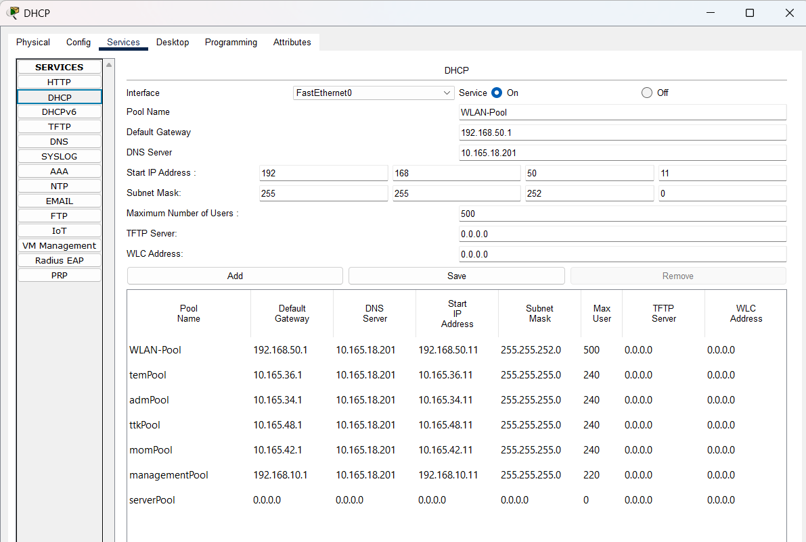

# 🏢 XYZ BPO Company — Enterprise Network Documentation

Welcome to the official network architecture and implementation repository for **XYZ BPO Company**. This document outlines the comprehensive subnetting scheme, server directory, interconnect links, and the deployment roadmap.

---

## 🌐 IP Addressing & Subnet Architecture

### Internal Networks & VLAN Subnets

| Category | Network / Subnet Mask | Valid Host Address Range | Default Gateway |
| --- | --- | --- | --- |
| **Management** | `192.168.10.0/24` | `192.168.10.1` – `192.168.10.254` | `192.168.10.1` |
| **WLAN** | `10.165.50.0/24` | `10.165.50.1` – `10.1658.50.254` | `10.165.50.1` |
| **VOIP** | `10.165.70.0/24` | `10.165.70.1` – `10.165.70.254` | `10.165.70.1` |
| **DMZ** | `10.165.18.0/25` | `10.165.18.1` – `10.165.18.126` | `10.165.18.1` |
| **Inside Servers** | `10.165.18.128/25` | `10.165.18.129` – `10.165.18.254` | `10.165.18.129` |
| **MOM** | `10.165.42.0/24` | `10.165.42.1` – `10.165.42.254` | `10.165.42.1` |
| **TTK** | `10.165.48.0/24` | `10.165.48.1` – `10.165.48.254` | `10.165.48.1` |
| **TEM** | `10.165.36.0/24` | `10.165.36.1` – `10.165.36.254` | `10.165.36.1` |
| **ADM** | `10.165.34.0/24` | `10.165.34.1` – `10.165.34.254` | `10.165.34.1` |
| **Blackhole** | — | — | — |

---

### External, Cloud & Interconnect Networks

| Connection / Link Description | Network Address |
| --- | --- |
| **Cloud Area** | `8.0.0.0/8` |
| **NTT - Internet** | `20.20.20.0/30` |
| **iForte - Internet** | `30.30.30.0/31` |
| **NTT - CTM-FW-1** | `105.100.50.0/30` |
| **NTT - CTM-FW-2** | `105.100.50.4/30` |
| **iForte - CTM-FW-1** | `205.200.100.0/30` |
| **iForte - CTM-FW-2** | `205.200.100.4/30` |
| **CTM-FW-1 to CTM-CS-1** | `10.2.2.0/30` |
| **CTM-FW-1 to CTM-CS-2** | `10.2.2.4/30` |
| **CTM-FW-2 to CTM-CS-1** | `10.2.2.8/30` |
| **CTM-FW-2 to CTM-CS-2** | `10.2.2.12/30` |

---

## 🖥️ Inside Server Farm Directory

| Server Role | IP Address |
| --- | --- |
| **DHCP Server** | `10.165.18.205` |
| **Primary DNS (DNS)** | `10.165.18.201` |
| **Secondary DNS (DNS2)** | `10.165.18.202` |
| **RADIUS Server** | `10.165.18.203` |

---

## VLAN Interfaces
### CTM-CS-1 Active/Standby
|  VLAN | Name | IP Address | VIP |
| --- | --- | --- | --- |
| **10** |  **Management** | `192.168.10.3` | `192.168.10.1`  |
| **18** | **Inside Servers** | `10.165.18.131` | `10.165.18.129` |
| **34** | **ADM** | `10.165.34.3` | `10.165.34.1` |
| **36** | **TEM** | `10.165.36.3` | `10.165.36.1` |
| **42** | **MOM** | `10.165.42.3` | `10.165.42.1` |
| **48** | **TTK** | `10.165.48.3` | `10.165.48.1` |
| **50** | **WLAN** | `10.165.50.3` | `10.165.50.1` |
| **70** | **VOIP** | `10.165.70.3` | `10.165.70.1` |

### CTM-CS-2 Active/Standby
|  VLAN | Name | IP Address | VIP |
| --- | --- | --- | --- |
| **10** |  **Management** | `192.168.10.2` | `192.168.10.1`  |
| **18** | **Inside Servers** | `10.165.18.130` | `10.165.18.129` |
| **34** | **ADM** | `10.165.34.2` | `10.165.34.1` |
| **36** | **TEM** | `10.165.36.2` | `10.165.36.1` |
| **42** | **MOM** | `10.165.42.2` | `10.165.42.1` |
| **48** | **TTK** | `10.165.48.2` | `10.165.48.1` |
| **50** | **WLAN** | `10.165.50.2` | `10.165.50.1` |
| **70** | **VOIP** | `10.165.70.2` | `10.165.70.1` |

|


## Implementation Roadmap & Status Checklist

### * [x] **0.** Create network topology architecture
### * [x] **1.** Basic device configuration on L2 & L3 switches (SSH, credentials, and baseline ACLs)
```
en
conf t
hostname CTM-CS-2
enable secret Jakarta12345


line con 0
 password Jakarta12345
 logging synchronous
 login
 exec-timeout 3 0
exit

no ip domain-lookup
ip domain-name xyz.com

crypto key generate rsa general-keys modulus 1024

ip ssh ver 2

username t1-adm-ardiyanto.6 privilege 15 secret Tele_1234567

banner motd &NO unauthorized access to this network device&

access-list 1 permit 192.168.10.0 0.0.0.255
access-list 1 deny any


line vty 0 15
 access-class 1 in
 login local
 transport input ssh

do wr


```
### * [x] **2.** VLAN assignment, access ports, and trunk ports configuration on L2 and L3 switches
```
en

conf t

int range f0/1-2
sw mode trunk
exit

vlan 10
name Management
vlan 42
name momcozy
vlan 48
name BD
vlan 36
name Temp
vlan 70
name Voice
vlan 99
name Blackhole
vlan 18
name Inside-Servers
vlan 34
name Admin
vlan 50
name WLAN

int range f0/4-5
sw mode access
sw access vlan 34

int f0/6
sw mode access
sw voice vlan 70

int f0/7
sw mode access
sw access vlan 50

int range f0/8-24, g0/1-2
sw mode access
sw access vlan 99
shut

do wr
```
### * [x] **2.0.** EtherChannel link aggregation setup
#### CTM-CS-1 LACP Active
```
int range g1/0/23-24
channel-group 10 mode active
```
#### CTM-CS-2 LACP Active
```
int range g1/0/23-24
channel-group 10 mode active
```


### * [x] **2.1.** Spanning Tree Protocol (STP) PortFast and BPDU Guard configurations on all access ports
On all non trunk ports
```
spanning-tree portfast
spanning-tree bdpuguard enabled
```
### * [x] **3.** EtherChannel validation and testing
### * [x] **4.** Subnetting and IP addressing implementation on L3 switches
### * [x] **5.** HSRP high availability, Inter-VLAN routing, and IP DHCP helper address configuration
---
#### CTM-CS-1
```
int vlan 10
ip add 192.168.10.3 255.255.255.0
standby 10 ip 192.168.10.1
ip helper-address 10.165.18.205

int vlan 18
ip add 10.165.18.131 255.255.255.128
standby 18 ip 10.165.18.129

int vlan 34
ip add 10.165.34.3 255.255.255.0
standby 34 ip 10.165.34.1
ip helper-address 10.165.18.205

int vlan 36
ip add 10.165.36.3 255.255.255.0
standby 36 ip 10.165.36.1
ip helper-address 10.165.18.205

int vlan 42
ip add 10.165.42.3 255.255.255.0
standby 42 ip 10.165.42.1
ip helper-address 10.165.18.205

int vlan 48
ip add 10.165.48.3 255.255.255.0
standby 48 ip 10.165.48.1
ip helper-address 10.165.18.205

int vlan 50
ip add 10.165.50.3 255.255.255.0
standby 50 ip 10.165.50.1
ip helper-address 10.165.18.205 
```
#### CTM-CS-2
```
int vlan 10
ip add 192.168.10.2 255.255.255.0
standby 10 ip 192.168.10.1
ip helper-address 10.165.18.205

int vlan 18
ip add 10.165.18.130 255.255.255.128
standby 18 ip 10.165.18.129

int vlan 34
ip add 10.165.34.2 255.255.255.0
standby 34 ip 10.165.34.1
ip helper-address 10.165.18.205

int vlan 36
ip add 10.165.36.2 255.255.255.0
standby 36 ip 10.165.36.1
ip helper-address 10.165.18.205

int vlan 42
ip add 10.165.42.2 255.255.255.0
standby 42 ip 10.165.42.1
ip helper-address 10.165.18.205

int vlan 48
ip add 10.165.48.2 255.255.255.0
standby 48 ip 10.165.48.1
ip helper-address 10.165.18.205

int vlan 50
ip add 10.165.50.2 255.255.255.0
standby 50 ip 10.165.50.1
ip helper-address 10.165.18.205
```
---
### * [x] **6.** Static IP address assignments for DMZ and server farm devices

| Server Role | IP Address |
| --- | --- |
| **DHCP Server** | `10.165.18.205` |
| **Primary DNS (DNS)** | `10.165.18.201` |
| **Secondary DNS (DNS2)** | `10.165.18.202` |
| **RADIUS Server** | `10.165.18.203` |
| **FTP Server** | `10.165.18.10` |
| **Web Server** | `10.165.18.11` |
| **Email Server** | `10.165.18.12` |
| **App Server** | `10.165.18.13` |
| **NAS Server** | `10.165.18.14` |

### * [ ] **7.** DHCP server device configuration and scope provisioning




### * [ ] **8.** OSPF dynamic routing configuration across firewalls, routers, and switches

#### CTM-CS-1
```
en

conf t

router ospf 35
 router-id <1.1.1.1>
 network 10.2.2.8 0.0.0.3 area 0
 network 10.2.2.0 0.0.0.3 area 0
 network 192.168.10.0 0.0.0.255 area 0
 network 192.168.50.0 0.0.0.255 area 0
 network 10.165.70.0 0.0.0.255 area 0
 network 10.165.18.0 0.0.0.127 area 0
 network 10.165.18.128 0.0.0.127 area 0
 network 10.165.42.0 0.0.0.255 area 0
 network 10.165.48.0 0.0.0.255 area 0
 network 10.165.36.0 0.0.0.255 area 0
 network 10.165.34.0 0.0.0.255 area 0
 do wr

```

#### CTM-CS-2
```
en

conf t

router ospf 35
 router-id 2.2.2.2
 network 10.2.2.4 0.0.0.3 area 0
 network 10.2.2.12 0.0.0.3 area 0
 network 192.168.10.0 0.0.0.255 area 0
 network 192.168.50.0 0.0.0.255 area 0
 network 10.165.70.0 0.0.0.255 area 0
 network 10.165.18.0 0.0.0.127 area 0
 network 10.165.18.128 0.0.0.127 area 0
 network 10.165.42.0 0.0.0.255 area 0
 network 10.165.48.0 0.0.0.255 area 0
 network 10.165.36.0 0.0.0.255 area 0
 network 10.165.34.0 0.0.0.255 area 0
 do wr

```
#### NTT ISP router

```
en
conf t
hostname NTT
router ospf 35
 router-id 3.3.3.3
 network 105.100.50.0 0.0.0.3 area 0
 network 105.100.50.4 0.0.0.3 area 0
 network 20.20.20.0 0.0.0.3
 network 20.20.20.0 0.0.0.3 area 0
 do wr
```

#### iForte ISP router
```
en
conf t
hostname iForte
router ospf 35
router-id 4.4.4.4
network 205.200.100.4 0.0.0.3 area 0
network 205.200.100.0 0.0.0.3 area 0
network 30.30.30.0 0.0.0.3 area 0
do wr
```

#### Router 3
```
en
conf t
hostname Router3
router ospf 35
router-id 5.5.5.5p
network 20.20.20.0 0.0.0.3 area 0
network 30.30.30.0 0.0.0.3 area 0
do wr

```


### * [ ] **9.** Firewall interface security zones and security levels definition

#### CTM-FW-1
```
en
config t
hostname CTM-FW-1

int gig1/3
no sh
ip add 10.2.2.2 255.255.255.252
nameif INSIDE1-CTM-CS-1
security-level 100

int gig1/4
no sh
ip add 10.2.2.6 255.255.255.252
nameif INSIDE2-CTM-CS-2
security-level 100

int gig1/5
no sh
ip add 10.165.18.1 255.255.255.128
nameif DMZ
security-level 70

int g1/2
no sh
ip add 205.200.100.1 255.255.255.252
nameif OUTSIDE2-iForte
security-level 0

int g1/1
no sh
ip add 105.100.50.1 255.255.255.252
nameif OUTSIDE1-NTT
security-level 0
write mem

```
#### CTM-FW-2
```
en
conf t
hostname CTM-FW-2

int g1/3
no sh
ip add 10.2.2.10 255.255.255.252
nameif INSIDE1-CTM-CS-1
security-level 100

int g1/4
no sh
ip add 10.2.2.14 255.255.255.252
nameif INSIDE2-CTM-CS-2
security-level 100

int g1/1
no sh
ip add 105.100.50.5 255.255.255.252
nameif OUTSIDE1-NTT
security-level 0

int g1/2
no sh
ip add 205.200.100.5 255.255.255.252
nameif OUTSIDE2-iForte
security-level 0

write mem

```
### * [ ] **9.1** Firewall Static & OSPF routing  
#### CTM-FW-1
```
en
conf t
!
route OUTSIDE1-NTT 0.0.0.0 0.0.0.0 105.100.50.2 1
route OUTSIDE2-iForte 0.0.0.0 0.0.0.0 205.200.100.2 20
!

!
router ospf 35
 router-id 1.1.2.2
 network 10.2.2.0 255.255.255.252 area 0
 network 10.2.2.4 255.255.255.252 area 0
 network 105.100.50.0 255.255.255.252 area 0
 network 205.200.100.0 255.255.255.252 area 0
 network 10.165.18.0 255.255.255.128 area 0
 write mem
!
```
#### CTM-FW-2
```
en
conf t
!
route OUTSIDE1-NTT 0.0.0.0 0.0.0.0 105.100.50.6 1
route OUTSIDE2-iForte 0.0.0.0 0.0.0.0 205.200.100.6 20
!
!
router ospf 35
 router-id 1.1.3.3
 network 205.200.100.4 255.255.255.252 area 0
 network 105.100.50.4 255.255.255.252 area 0
 network 10.2.2.8 255.255.255.252 area 0
 network 10.2.2.12 255.255.255.252 area 0
!
write mem
```

### * [ ] **10.** Firewall inspection policy and security rules configuration
#### CTM-CS-1
```
en
conf t

object network INSIDE1-CTM-CS-1-OUTSIDE1-NTT-WLAN
subnet 10.165.50.0 255.255.255.0
nat (INSIDE1-CTM-CS-1,OUTSIDE1-NTT) dynamic interface

object network INSIDE1-CTM-CS-1-OUTSIDE2-iForte-WLAN
subnet 10.165.50.0 255.255.255.0
nat (INSIDE1-CTM-CS-1,OUTSIDE2-iForte) dynamic interface

object network INSIDE2-CTM-CS-2-OUTSIDE1-NTT-WLAN
subnet 10.165.50.0 255.255.255.0
nat (INSIDE2-CTM-CS-2,OUTSIDE1-NTT) dynamic interface

object network INSIDE2-CTM-CS-2-OUTSIDE2-iForte-WLAN
subnet 10.165.50.0 255.255.255.0
nat (INSIDE2-CTM-CS-2,OUTSIDE2-iForte) dynamic interface
```
**wip**

int vlan 18
ip add 10.165.18.130 255.255.255.128
standby 18 ip 10.165.18.129

int vlan 34
ip add 10.165.34.2 255.255.255.0
standby 34 ip 10.165.34.1
ip helper-address 10.165.18.205

int vlan 36
ip add 10.165.36.2 255.255.255.0
standby 36 ip 10.165.36.1
ip helper-address 10.165.18.205

int vlan 42
ip add 10.165.42.2 255.255.255.0
standby 42 ip 10.165.42.1
ip helper-address 10.165.18.205

int vlan 48
ip add 10.165.48.2 255.255.255.0
standby 48 ip 10.165.48.1
ip helper-address 10.165.18.205

int vlan 50
ip add 10.165.50.2 255.255.255.0


### * [ ] **11.** Wireless network (WLAN) infrastructure configuration
### * [ ] **12.** VoIP infrastructure and QoS/VLAN configs
### * [ ] **13.** End-to-end verification and testing of network functionality

---
